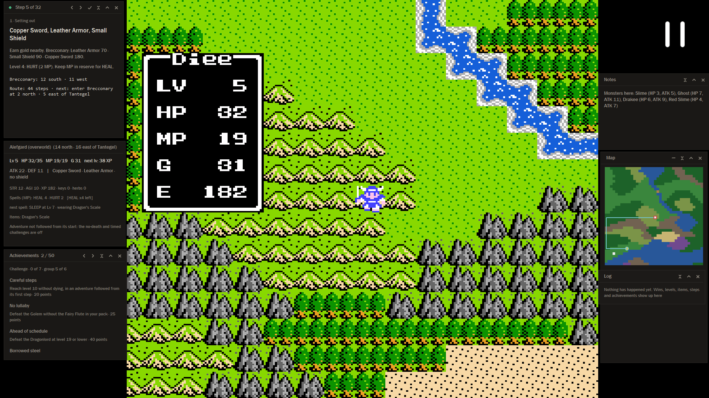

# Retro Companion

A game library with live walkthrough overlays for RetroArch. Pick a game, press PLAY, and an
always-on-top overlay follows what happens in the game by reading its memory: next step,
route on a live map, enemy stats in battle, your own stats.

Included game: **Dragon Warrior** (NES, 1989).

Download: https://retro.dieergames.hu. Nothing from the games comes with the program: on
first start you choose your own ROM (Dragon Warrior (USA), first release), and the app reads
the maps, monster tables and the rest from it and keeps them in `~/RetroCompanion/data`.
Until then the walkthrough, achievements and stats work, but the map, routes, monster lists
and battle details are off.

## Start

    python run.py

Needs Python 3.8+ with tkinter (the python.org Windows installer includes it). To get a
single `RetroCompanion.exe`, run `build_exe.bat` on Windows.

## RetroArch setup

- Settings > Video > Fullscreen Mode > **Windowed Fullscreen = ON**, otherwise the overlay is
  hidden behind the game.
- Settings > Network > **Network Commands = ON**. Games started with the PLAY button get this
  switched on for that session automatically.
- NES core: **Mesen** is recommended (it exposes the memory map). Other cores fall back to a
  second read command.

You can also start a game in RetroArch yourself; a supported game is detected and its
overlay opens on its own.

## Overlay keys

With the overlay focused, or on Windows with Ctrl+Shift held while RetroArch is the active
window (the shortcuts are left alone in every other program, and when no overlay is open):

| Key | Action |
| --- | --- |
| Left / Right | page through the steps |
| A | back to the automatic current step |
| D | mark the shown step done / skip it |
| M | map on/off |
| Z | map zoom |
| S | my stats on/off |
| L | location notes on/off |
| H | collapse / expand every module |
| C | compact / full size, every module |
| F | full-size map |

## Overlay modules

The overlay is a set of small windows: the guide (current step), your stats, the battle
(only during a fight), the map, the location notes, the achievements and the log.

The achievements module lists every achievement of the game one group at a time, earned or
still open; the arrows in its header page through the groups. The log shows what happened,
newest first: enemies beaten, levels gained, items found, steps finished, achievements earned.
It is kept on this computer. Both lists scroll with the mouse wheel. An earned achievement
carries a trophy in the colour of its grade.

## The full-size map

F, or the corner icon in the map module's header, opens one large window with the whole
map. Drag it to move, turn the wheel to zoom, click a mark to read what is there, and
double-click a place to open its own map; every town, cave and dungeon floor has one, with
its chests, what is in them, and where each staircase leads. A click on open ground of the
overworld lists the monsters of that area.

Every place carries one of five marks: the current step is here, something is still to do,
it is needed later in the walkthrough (drawn faint), everything is done, or it is optional
and never needed. The filters switch towns, caves, quest spots, chests, stairs, monster
zones, the route and the names on and off.

Every module has a **compact form**: the two chevrons in its header shrink it to one
strip with an icon and the main figures (the step, your HP and gold, the enemy's HP bar, a
small map, the latest log line), so the overlay covers little of the game. The button at the
end of the strip, or a double-click, brings the full module back. C switches all of them.

Each module can be

- **moved**: drag its header. Until you move a module it stays docked in a column under the
  guide and follows it; a column that would run off the screen continues beside it.
- **resized**: drag its right edge (width), bottom edge (height) or the corner (both).
  Text re-wraps and the map rescales to fit. Height follows the content until you set it;
  after that longer content scrolls with the mouse wheel. Double-click the bottom edge to
  let the height follow the content again.
- **collapsed**: the arrow in its header. The × hides the module (on the guide it closes
  the overlay).

Right-click any module for the same actions, text size, transparency and **Reset layout**,
which docks everything again. The layout is remembered per game.

## RetroArch messages and Discord

Three switches in the settings. An earned achievement can also be shown as a message inside
RetroArch (on by default; it is the only sign in exclusive fullscreen, where the overlay
cannot show), and RetroArch can save a screenshot at that moment (off by default). Discord
can show the game, your level and place and the step you are on (off by default). It works
through the Discord program on the same computer and needs a Discord application ID, a
public number entered in the settings until Retro Companion has its own.

## Ideas

"Ideas" at the bottom of the sidebar, and the Ideas page of the website, list the features
players have asked for: planned, open for votes, done. Anyone with an account can suggest
one and vote; one account has one vote on each idea. A new idea is read by the maintainer
before everyone sees it. On the server: `python app.py idea` lists them,
`idea <id> <status> [answer]` reviews one, `idea add <title> <text> [status]` adds one.

## Where things are stored

`~/.retro_companion.json` holds settings, ROM locations, play time and progress.

## Achievements

Each game has its own achievements; the game page lists them on the **Achievements** tab,
with points, progress on the counted ones and the day each was earned. When one unlocks
while you play, a card slides in at the top of the screen for a few seconds with the trophy
of its grade and the companion's own chime (made in code; "Achievement sound on / off" in
the overlay's right-click menu). Achievements are kept for good: a new game or "Reset
progress" does not take them away.

Dragon Warrior has 50 of them, 940 points in all:

| Group | What it rewards |
| --- | --- |
| The quest (16) | every milestone from leaving the throne room to the Dragonlord |
| The hero (8) | levels 10, 20 and 30, all ten spells, Erdrick's full gear, gold, keys |
| Battle (10) | wins, Metal Slimes, Goldmen, the three dragons, all 38 kinds of monster |
| The land (5) | every town, every one of the 29 maps, rare finds |
| Challenge (7) | no deaths, no flute against the Golem, the Dragonlord early, fast, or without Erdrick's Sword |
| Hidden (4) | shown only once you stumble on them |

Some challenges ask for "an adventure followed from its first step": the companion has to
be running when you start the new game, because the game itself keeps no record of deaths
or play time. The stats module of the overlay says whether the current adventure is being
followed, with its deaths and play time. Adventures are told apart by the hero's name and
the save file, so the three save files do not mix. Everything is judged from the game's
memory while it runs, so only what happens with the companion open counts; milestones
that the save itself remembers (items, levels, story flags) are awarded as soon as that
save is loaded.

## Profile, trophies and the shop

The block at the bottom of the sidebar is your profile across all games; click it to open
it. Every achievement is also a trophy: bronze under 15 points, silver from 15, gold from
30, and all achievements of one game earn its platinum (100 points more). Points from
every game add up to a level (100, 300, 600, 1000, 1500 points and so on).

Points can also be spent, in the shop inside the profile window. It sells what can only be
had for points: other colour themes, extra overlay modules (the first one is a trophy
tracker), achievement chimes (each can be heard before buying), pop-up styles and frames
for the profile picture. Each item has a price and a level it needs. Spending does not lower your level.
The walkthrough, the map and the achievements themselves never cost anything.

The profile lives in the settings file on your computer. An account is optional.

The profile has a picture: one of twenty built-in portraits (drawn in code), or a PNG or GIF
of your own, which is copied to `~/RetroCompanion` and stays on your computer. "What's new"
at the bottom of the sidebar lists the new features with their dates; the website shows
the same list (`companion/news.py`, written to `site/news.html` by `tools/make_guides.py`).

## Account and leaderboard

In the profile window you can create an account with an email address, a player name and
a password, or sign in to one. Signed in, the app sends your trophies, achievement
progress, walkthrough steps, play time and bought shop items to the server and takes back
what you earned on other computers: sign in on a second computer and everything is there.
Nothing is ever taken away by a sync; two computers end up with what both earned.

The server counts the points itself from the achievements unlocked and keeps the public
leaderboard (player name, points, level, trophy counts; never the email address). The
leaderboard is also on the website: https://retro.dieergames.hu. What is stored and for
how long: https://retro.dieergames.hu/privacy. "Delete account" in the profile window
removes it all.

The app syncs at start, when a trophy unlocks, every five minutes while you play and when
you quit. The password is sent once to get a sign-in token and is never stored.

## Game information from MobyGames

The **About** tab of a game shows its release date, genres, developer, publisher and
description from [MobyGames](https://www.mobygames.com/). It needs your own MobyGames API
key (their API is a paid subscription; the Hobbyist plan is enough): paste it in Settings.
The entry is fetched once and kept for a month.

## Design

The look follows the rules of [unslop](https://github.com/heydamir/unslop) by Damir
Sokolovsky (@heydamir), CC BY 4.0: quiet warm-neutral chrome, one accent, colour kept for
the maps. The tokens and the written direction are in `companion/theme.py`.

## Adding a game

A game is one Python file that defines `PLUGIN`, an instance of a `GamePlugin` subclass.
Put it in `games/` and list it in `games/__init__.py`, or drop it into
`~/RetroCompanion/games/` and it is loaded at start. `games/dragon_warrior.py` is the
worked example; `companion/plugin.py` documents the contract.

A plugin provides:

| Field / method | Purpose |
| --- | --- |
| `id`, `title`, `system`, `year`, `publisher`, `blurb`, `accent` | library entry |
| `cores`, `rom_exts` | how PLAY launches it |
| `crc32`, `name_pattern` | how the running game is recognised |
| `memory` | `(address, length, required)` ranges read every tick |
| `parse(blocks)` | bytes to a state object, or `None` on title screens |
| `steps` | the walkthrough: `id`, `ch`, `title`, `lines` |
| `step_done(step, state, seen)` | is a step finished |
| `observe(state, seen)` | remember facts memory forgets (places visited) |
| `view(state, ctx)` | what the overlay shows: stats, battle, directions, notes, map |
| `atlas(state, ctx)` | the full-size map: every map, its marks with a status, filters (see `companion/atlas.py`) |
| `summary(state)`, `banner()` | library extras |
| `data_status()`, `prepare(rom_path)` | for tables read from the player's own ROM instead of being shipped |
| `achievements` | list of `id`, `group`, `title`, `text`, `points`, optional `secret` |
| `track(state, prev, memo, dt)` | note what memory forgets (kills, deaths, moments) in `memo` |
| `achieved(ach, state, memo)` | `True`/`False`, or `(current, total)` for counted ones |

The platform does the rest: finding and launching RetroArch, detection, polling, the
overlay window, map drawing, progress, play time.

## Building and releases

`build_exe.bat` builds `dist\RetroCompanion.exe` on your own Windows machine. The published
builds are made by GitHub Actions from this repository (`.github/workflows/build.yml`): a
version tag builds the exe and attaches it to a release together with its SHA-256.

The program is not code signed yet, so Windows shows a warning for the download. Compare the
SHA-256 of your file with the one on the release page.

`tests/test_platform.py` needs the Dragon Warrior tables read from your own ROM (see above),
so it runs locally, not in the build.

## License

MIT, see `LICENSE`. The DieerGames name and logo (`site/img/dieergames.png`) are not part of
that grant: use your own mark in a fork. Game names belong to their owners. No game data is
in this repository.
